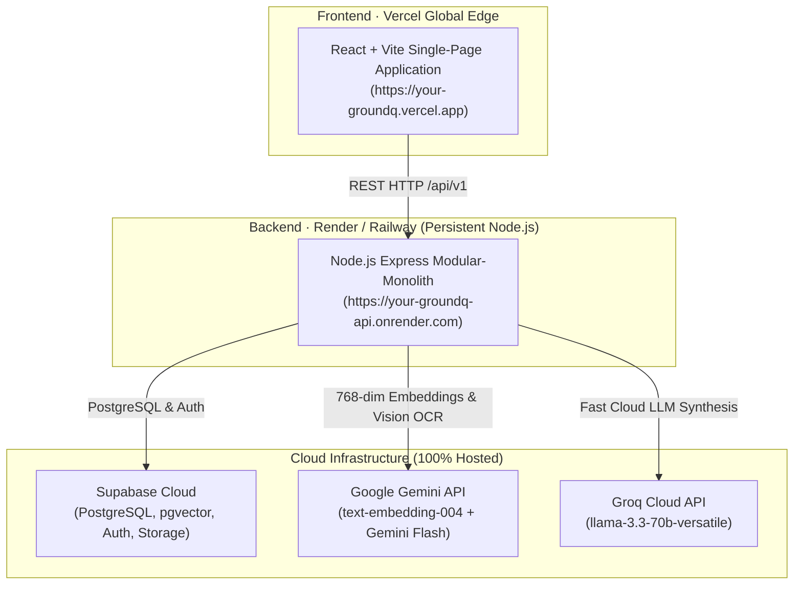

# GroundQ Production Deployment Guide

This guide provides step-by-step instructions for deploying GroundQ live so anyone can access and use the platform via a public web link with maximum performance and zero reliance on local Ollama.

---

## Architecture Topology for Live Hosting



### Why This Architecture Gives Maximum Performance
1. **Frontend on Vercel**: Sub-50ms Global Edge CDN, instant TLS/SSL, zero server maintenance, and fast asset delivery.
2. **Backend on Render / Railway**: Persistent Node.js container avoiding Vercel serverless function freezing and 10-second timeouts. Document chunking, vision OCR, and blueprint generation run continuously at full speed.
3. **100% Cloud APIs (Zero Local Ollama Required)**:
   - **Vector Embeddings**: Powered by Google Gemini `text-embedding-004` (768 dimensions, identical to `nomic-embed-text` pgvector schema).
   - **Multimodal OCR**: Powered by Google Gemini Multimodal Vision API with Gemini Files API sliding windows.
   - **Synthesis**: Powered by Google Gemini Flash & Groq Llama 3.3.

---

## Step 1: Deploy Backend to Render (Free / Hobby Tier)

1. Push your repository to your GitHub account:
   ```bash
   git push origin main
   ```
2. Log in to [Render.com](https://render.com).
3. Click **New +** → **Blueprint** (or **Web Service**).
4. Connect your GitHub repository. Render will automatically detect `render.yaml`.
5. If creating as a manual **Web Service**:
   - **Name**: `groundq-api`
   - **Environment**: `Node`
   - **Build Command**: `pnpm install --frozen-lockfile && pnpm --filter @groundq/contracts build && pnpm --filter @groundq/api build`
   - **Start Command**: `node apps/api/dist/server.js`
6. Add the following **Environment Variables** in the Render dashboard:

| Variable | Value / Description |
| :--- | :--- |
| `NODE_ENV` | `production` |
| `PORT` | `10000` (Render sets this automatically) |
| `SUPABASE_URL` | Your Supabase Project URL (`https://your-project.supabase.co`) |
| `SUPABASE_ANON_KEY` | Your Supabase anon public key |
| `GEMINI_API_KEY` | Your Google Gemini API Key |
| `GROQ_API_KEY` | *(Optional)* Your Groq API Key |
| `WEB_ORIGIN` | `*` (or your Vercel URL once deployed) |

7. Click **Create Web Service**. Once deployed, Render will provide your backend URL (e.g. `https://groundq-api.onrender.com`).
8. Verify health check by visiting: `https://groundq-api.onrender.com/api/v1/health` → returns `{"status":"ok"}`.

---

## Step 2: Deploy Frontend to Vercel

1. Log in to [Vercel.com](https://vercel.com).
2. Click **Add New...** → **Project**.
3. Import your GitHub repository.
4. Configure Project Settings:
   - **Framework Preset**: `Vite`
   - **Root Directory**: `./` (leave default, `vercel.json` at root handles build & rewrites)
   - **Build Command**: `pnpm --filter @groundq/contracts build && pnpm --filter @groundq/web build`
   - **Output Directory**: `apps/web/dist`
   - **Install Command**: `pnpm install`
5. Under **Environment Variables**, add:

| Variable | Value |
| :--- | :--- |
| `VITE_API_URL` | `https://groundq-api.onrender.com` (Your Render backend URL from Step 1) |
| `VITE_SUPABASE_URL` | Your Supabase Project URL |
| `VITE_SUPABASE_ANON_KEY` | Your Supabase anon public key |

6. Click **Deploy**.
7. Vercel will build and assign you a live HTTPS URL (e.g. `https://groundq.vercel.app`).

---

## Step 3: Supabase Authentication Redirect URL (1 Minute)

To allow users to sign up and log in on your live Vercel URL:
1. Go to your [Supabase Dashboard](https://supabase.com/dashboard) → Select your project.
2. Navigate to **Authentication** → **URL Configuration**.
3. Under **Site URL**, enter your live Vercel URL: `https://groundq.vercel.app`.
4. Under **Redirect URLs**, add:
   - `https://groundq.vercel.app/**`
   - `http://localhost:5173/**` (keeps local dev working)
5. Click **Save**.

---

## Step 4: Verification Checklist

1. Open your live link: `https://groundq.vercel.app`.
2. Sign in or create an account.
3. Create a test Course Workspace (e.g., "Distributed Systems").
4. Upload a document (PDF, DOCX, PPTX, or Image).
5. Watch real-time processing extract content and generate embeddings using Gemini API (no Ollama required).
6. Generate questions in Generation Studio.
7. Share your Vercel link with anyone!
