# GroundQ Documentation Hub

Welcome to the official technical documentation repository for **GroundQ: Syllabus-Grounded Controllable Question Generation Platform**.

This documentation hub serves as the **sole authoritative knowledge base** for developers, AI coding agents, architects, and instructors working on or extending this codebase. Any engineer or agent onboarding to this project must read these documents in the sequence specified below before modifying code.

---

## Authoritative Document Navigation

| Document | Primary Audience | Scope & Purpose |
| :--- | :--- | :--- |
| **[`PRD.md`](./PRD.md)** | Product, Engineering, QA | **Product Requirements Document**: Complete product definition, user roles, feature specifications, dual-engine hybrid strategy, pedagogical constraints (Bloom L1–L6), and non-goals. |
| **[`SYSTEM_DESIGN.md`](./SYSTEM_DESIGN.md)** | Architects, Engineers | **System Design & Technical Architecture**: Localhost modular-monolith topology, Dual-Engine AI Provider subsystem (`GeminiProvider` + `OllamaProvider`), RAG indexing & retrieval pipeline, generation planning, multi-constraint validation engine, and failure mitigation runbooks. |
| **[`DATABASE_DESIGN.md`](./DATABASE_DESIGN.md)** | Backend, DBAs | **Database Persistence & Vector Specification**: Complete PostgreSQL schema, table descriptions, column types, foreign keys, cascading rules, pgvector indexing, Row-Level Security (RLS) policies, and reference taxonomies. |
| **[`API_SPEC.md`](./API_SPEC.md)** | Frontend, Backend, Integrators | **HTTP REST API Specification**: Complete `/api/v1` contract documentation, request/response JSON schemas, authentication/authorization requirements, query parameters, error contracts, and status transitions. |
| **[`HANDOVER_GUIDE.md`](./HANDOVER_GUIDE.md)** | New Developers & Coding Agents | **Engineer & Agent Handover Manual**: Step-by-step setup, environment variable configuration, local Ollama model management, running test suites, verified project boundaries, and disaster recovery. |
| **[`LOG.md`](./LOG.md)** | All Contributors | **Master Implementation Chronology**: Continuous audit trail of every implemented feature, database migration, API route, UX enhancement, bug fix, and automated test result since repository inception. |
| **[`decisions/`](./decisions/)** | Architects, Tech Leads | **Architectural Decision Records (ADRs)**: Formal records of critical architectural choices (e.g., Local Modular Monolith, Dual-Engine Inference, Elimination of Heuristic Slot-Fillers). |

---

## The GroundQ Core Workflow

GroundQ is structured as a deterministic 4-stage pipeline rather than an uncontrolled single-shot LLM prompt:

```mermaid
flowchart LR
    subgraph S1["1. Resource Ingestion"]
        A["PDF / DOCX Upload"] --> B["Page & Byte-Span Chunking"]
        B --> C["Local Vector Embeddings<br/>(nomic-embed-text)"]
    end

    subgraph S2["2. Curriculum Hierarchy"]
        C --> D["Intelligent Topic Extraction<br/>(Gemini 2.0 / Qwen 2.5)"]
        D --> E["Interactive Topic Editor<br/>(Modules & Subtopics)"]
    end

    subgraph S3["3. Controllable Generation"]
        E --> F["Multidimensional Blueprint<br/>(Count, Bloom, Format, Difficulty)"]
        F --> G["Discrete Question Planning<br/>(Topic-Aware RAG Retrieval)"]
        G --> H["Dual-Engine Synthesis<br/>(Gemini Flash / Qwen 2.5 Local)"]
    end

    subgraph S4["4. Verification & Bank"]
        H --> I["Automated Multi-Constraint Validation<br/>(Grounding, Deduplication, Schema)"]
        I --> J["Monotonic Question Bank<br/>(Review, Edit, Version History)"]
    end
```

---

## Golden Architectural Invariants

Every coding agent and human developer must strictly uphold these inviolable system invariants:

1. **Hybrid Multi-Engine AI Architecture**:
   - Primary Cloud Engine: **Google Gemini API** (`gemini-flash-lite-latest` / `gemini-3.5-flash-lite`, 500 RPD, 15 RPM) for instantaneous (1–3s), university-grade pedagogical synthesis with high daily quota.
   - High-Capacity Cloud Alternative: **Groq Cloud** (`llama-3.3-70b-versatile`, 14,400 RPD free tier) for high-frequency testing without quota exhaustion.
   - Offline Local Engine: **Ollama** (`qwen2.5:7b` / `qwen2.5:3b`) for 100% on-device private processing and classroom hardware demonstrations.
   - User Selection: Users can explicitly select their preferred engine in the Resources tab before topic extraction and in the Generation Studio blueprint.
2. **Batched Synthesis & Rate-Paced Cloud Execution**:
   - Cloud engines group targets into batches of 3 (`BATCH_SIZE = 3`), reducing API call volume by ~67%.
   - An automatic 1.5-second pacing throttle between cloud batches keeps execution well within 15 RPM limits.
   - Local CPU execution uses `BATCH_SIZE = 1` to prevent hardware timeouts.
3. **Full-Syllabus Stratified Sampling & Zero Artificial Caps**:
   - Resource chunk queries never impose arbitrary limits (no `.limit(100)`). All chunks across documents of any length (e.g. 200+ pages) are loaded.
   - Question planning employs stratified stride sampling (`stride = totalChunks / targetCount`) to guarantee uniform coverage spanning pages 1 to 200+.
4. **Balanced MCQ Option Distribution (Anti-Predictability)**:
   - MCQ options are programmatically shuffled using a deterministic Linear Congruential Generator (LCG) PRNG, guaranteeing a ~25% balanced distribution across Options A, B, C, and D.
   - Static schema template bias (e.g. correct answers clustering at Option B) is strictly eliminated in both prompt instructions and database insertion.
5. **Zero Fake Template Slot-Filling**:
   - Heuristic slot-fillers that paste raw document sentences into question templates (e.g., *"Which of the following describes [Topic]?"* with answer *"JavaScript notes, maintaining structural correctness"*) are **strictly prohibited**.
   - If an AI call fails or times out, the pipeline executes automated JSON self-healing or fails explicitly with diagnostic telemetry. Slop or corrupted questions are never persisted.
6. **Strict Project Isolation & Provenance**:
   - Every resource, chunk, topic, blueprint, generation run, question, version, and validation check belongs to a single authenticated project. Cross-project data leakage is strictly prohibited.
7. **Monotonic Question Numbering**:
   - Questions maintain monotonic, sequential `sort_order` across generation batches (`#01..#15`, `#16..#30`), preventing duplicated question badges in the assessment feed.
8. **Archive-First Lifecycle**:
   - Normal product actions never hard-delete domain entities. Soft deletion via `archived_at TIMESTAMP WITH TIME ZONE` preserves immutable academic audit trails.
9. **Localhost Modular Monolith**:
   - The application executes locally (React Vite + Express TypeScript). PostgreSQL, pgvector, and Auth reside on Supabase. Never introduce Kubernetes, microservices, or external ORMs (Prisma, TypeORM) without formal architectural approval.

---

## How to Onboard & Work on This Project

1. Read **[`AGENTS.md`](../AGENTS.md)** first for workspace operational guardrails.
2. Read **[`PRD.md`](./PRD.md)** to grasp functional and pedagogical requirements.
3. Read **[`SYSTEM_DESIGN.md`](./SYSTEM_DESIGN.md)** to understand the subsystem topology.
4. Read **[`DATABASE_DESIGN.md`](./DATABASE_DESIGN.md)** before writing any queries or schema migrations.
5. Read **[`API_SPEC.md`](./API_SPEC.md)** before touching frontend service hooks or backend Express routes.
6. Check **[`LOG.md`](./LOG.md)** to review the recent implementation history and avoid re-introducing previously fixed issues.
7. Follow **[`HANDOVER_GUIDE.md`](./HANDOVER_GUIDE.md)** for local setup, testing commands, and verification procedures.
